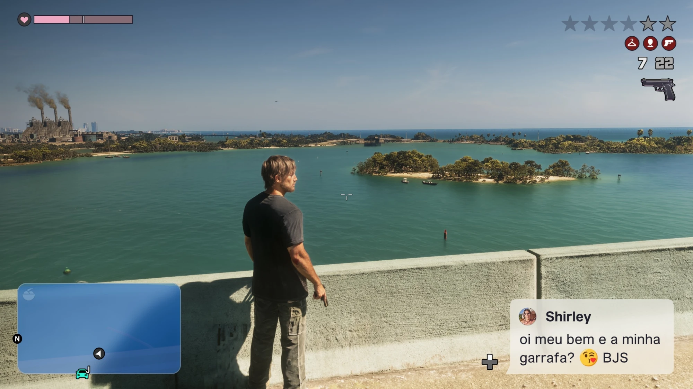
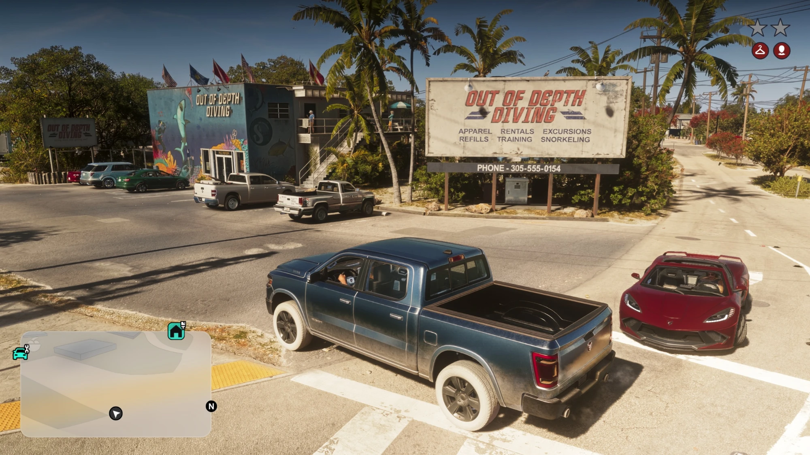

# RTX 5070 Ti + Ryzen 5 5600X: what made it playable here

A report of one PC, and of everything on this branch that differs from `main`. Maintainers can pick
what they want; nothing here is meant to be taken whole.

*Series X profile, DLAA at 2560x1440, DLSS model K, DLSS 5 Neural Rendering (OptiScaler DLSS5, "Max
quality"), DLSS Frame Generation 3X.*

## The PC

| | |
|---|---|
| CPU | AMD Ryzen 5 5600X (6 cores, 12 threads) |
| GPU | NVIDIA GeForce RTX 5070 Ti 16 GB, driver 617.14 |
| RAM | 32 GB |
| OS | Windows 11 (10.0.26200) |
| Streamline / DLSS | 2.14.16 with NGX 310.9.16 (`nvngx_dlss`, `nvngx_dlssg`, `nvngx_dlssd`) |

## Where the frame goes on this CPU

The layer is CPU-bound here, by a wide margin:

- The 8 list-translation threads (`VICTORY_THIN`) use about **456 ms of CPU per ~76 ms frame**,
  roughly six whole cores of a 5600X.
- The thread that prepares submissions worked **58-67 ms of each frame**.
- The card is only **30-45 % busy** (the frame line's "card about N% busy").

So anything that only costs the card (resolution, DLAA, the DLSS model, even DLSS 5) is close to free
here, and anything that saves card time does not move the frame. The RTX 5070 Ti Laptop notes in
`docs/findings.md` reached the same conclusion from the other side.

## Results

### What the screenshots ran

Series X, DLAA at 2560x1440, DLSS model K, DLSS 5 Neural Rendering, DLSS Frame Generation 3X, from
the play logs of two long sessions on this branch (28 Nov):

| Session | Length | Rendered fps in the world (median) | Frame generation |
|---|---|---|---|
| 1 | 34 min | 11.5 (most lines 10-15) | 19,671 rendered -> 57,400 shown |
| 2 | 17 min | 12.6 (7.8-16.3) | 4,412 rendered -> 13,202 shown |

That is about **35-38 fps on screen**, with no crash in either session. Before this work, the same PC
played at about 10 fps rendered (an older round of the layer, without frame generation).

### Fixed-spot A/B of the five CPU fixes below

On PR #18 (Series S, DLSS Quality, frame generation 2X), standing at the save's spawn point, about
7 minutes per run, compared with `scripts/compare-logs.py`:

| | Without | With |
|---|---|---|
| Rendered fps | 12.50 +- 0.08 | **12.74 +- 0.07** (+2 %) |
| Submitting thread, work per frame | 67.4 ms | **57.8 ms** (-14 %) |
| Its wait at the kept threads' join | 5.2 ms | 1.8 ms |
| Host-copy refreshes | 20.3 ms | 15.2 ms |
| Card idle behind the submitting thread | 30.4 ms | 17.8 ms |

The submitting thread lost 14 % of its work; the frame moved only 2 % because the list-translation
threads are the next limit on six cores. Run-to-run noise here is about +-9 % on short runs, so treat
the fps line as a direction and the per-thread times as the measurement.

## What is on this branch

### Merged from others (credited, unchanged except for conflicts)

- **PR #18** (Kemerd; and D Everett Hinton's merge of upstream into it): `-Fast` preset, send thread,
  pipelines from pieces, refresh sets, title write ranges, key rebinding, 21:9.
- **Upstream `main` up to v2026.11.28.01** (63b902f): FSR 3 frame generation, Windows 10 runtime,
  preload, save sharing, Series S picture row, water light and probe fixes, memory stack, audio DSP...
- **PR #145** (Walid ben miled): the AVX2 compare for refresh and copy-back runs.
- **PR #181** (BE29ZZ and the people credited there): pooled `shadow::exact()` buffers behind a
  read-locked cache.

Conflicts were resolved by keeping both sides; the notable ones:

- `host/menu.rs`: PR #18's key rebinding **and** upstream's save sharing, save-at-once and Series S
  picture row. The actions and the visible rows count PR #18's key lines.
- `pipeline/host.rs`: PR #18's sampler tables first; stages left with static samplers go through
  upstream's fixed static-sampler order.
- `pipeline/make.rs`: upstream's ray activation default (no magenta probes) and water light.
- `upload.rs` (in the earlier merge, kept): upstream's early pool and heap fallback with PR #18's
  out-of-reach windows, over one `allocate_between`.
- `host/card_steps.rs`: both sides had added a refusal counter; PR #18's bounded table is kept.
- `shadow.rs`: upstream's `VICTORY_WIDE_THREADS` (3/8 of the processors) with our own-batch join.

### Our changes (each with a switch back)

| Change | Where | Switch | Why |
|---|---|---|---|
| A caller of the kept threads runs only its own jobs while it waits | `shadow.rs` `wide_batch` | `VICTORY_WIDE_OWN=0` | The submitting thread took other callers' 1 MiB compares and merges while the frame waited for its own |
| Front refreshes that go to the threads, longest first | `host.rs` `big_first` | `VICTORY_REFRESH_BIG_FIRST=0` | The join no longer waits for one long span taken last |
| A short spin for the guards' lock | `watch.rs` `spin_for_guards` | `VICTORY_GUARDS_SPIN_US=0` | Held 7-18 us, but a sleeping waiter woke ~130 us later on a busy CPU (in an older round: faults 59 -> 31-35 us) |
| A host list's own scratch buffers are not waited for | `host.rs` `list_uav_buffer` | `VICTORY_LIST_BUFFERS_WAIT=1` | Only the list being recorded names them; it is sent after they exist. One 10-minute run waited 45,200 times, 25 s |
| No new reference when a slot keeps the same resource | `descriptor/host.rs` `keep_ref` | none (same result) | AddRef/Release per draw on the same few resources from all recording threads |
| Sampler runs share slots, 1024-slot pool | `pipeline/host.rs` | `VICTORY_PIPELINE_SAMPLER_REUSE=1` (F1: PIPELINE CACHE REUSE) | The 256-slot pool filled while loading; later stages fell back to static samplers and missed the library (864 bypasses -> 0; 2,858 pipelines from the library before the world) |
| F1: NEURAL RENDERING (INSERT) | `apps/victory/src/play.rs` `load_neural`, `main.rs`, `host/menu.rs` | off by default | DLSS 5 Neural Rendering through the OptiScaler DLSS5 mod, below |

Tested in our older round and **left off** because they made it slower on this CPU: batched resource
retirement together with raised helper-thread priority (-12 %), list-held descriptors (-6 %), and
`VICTORY_PORT_CONSTANTS` (5-7 fps: the card reads title memory over PCIe).

### DLSS 5 Neural Rendering (experimental)

The F1 switch makes `victory` load the **OptiScaler DLSS5** mod
([Skynizz/optiscaler-dlss5](https://github.com/Skynizz/optiscaler-dlss5) 1.3.0, GPL-3.0; built on
Dagherbou's OptiScaler_DLSSNR, colour composition from RenoDX) the way MFG Unlocker is loaded: from an
`optiscaler-dlss5` folder beside `victory.exe` or up to five folders above it (or `VICTORY_NEURAL_DIR`),
before the device and Streamline. **Insert** opens its menu (DLSS 5 tab: presets, passes, cache
interval, before/after the upscaler, strengths, regions); **F6** compares optimised / vanilla / off.

`scripts/setup-neural-rendering.ps1` builds that folder. NVIDIA's model (`nvngx_dlssnr.dll`, 310.8
here) is not redistributable and is not included. Two things were needed for frame generation to stay
on, both done by the script:

- **OptiScaler's own frame generation off** (`FGInput`/`FGOutput=nofg`): DLSS Frame Generation stays
  the layer's, through its own Streamline.
- **NVIDIA's DLLs where OptiScaler looks for them**: it stands in for NGX for Streamline
  (`_nvngx.dll` "returning this dll"), and looks for `nvngx_dlss*.dll` beside the executable as in a
  normal game. Without them it turned DLSS off and Streamline turned DLSS-G off ("Failed to obtain
  DLSS-G min spec requirements from NGX"). With `NvngxDlssPath` and the DLLs linked beside
  `victory.exe`, frame generation stays on (3X: 16 rendered -> 48 shown) and the model runs
  ("DLSS-NR running at 2560x1440").

Known issue: in 2 of 3 test starts the game **stalled in the intro**. Only with the mod loaded, the
layer ran out of dynamic descriptor slots when OptiScaler made its DLSS feature, frames stopped, and
the title's watchdog (`+0x23cf683`) ended the run about a minute later. Starts that get past the intro
have played for 17 and 34 minutes. `scripts/play.ps1 -NeuralRendering` starts again by itself when that
happens. A native integration (calling the model after the layer's own DLSS evaluation, without
OptiScaler's hooks) would avoid it; it is not attempted here.

## Findings worth knowing on this hardware

- **DLAA on Series S crashes at load**: the scene goes from 1280x720 to 1920x1080, the title's own
  allocator asks for ~8.9 MB that its console-sized pools do not have, and it breaks
  (`0x80000003` at `+0x2219650`, 3 of 3 starts). On Series X, DLAA at 2560x1440 runs.
- **A start failure in about one start in three**, every build: `0xc0000005` at `+0x2215c35`, a write
  to 0 right at the start of a title thread. More likely right after another instance closed.
  Starting again works; `scripts/play.ps1` does it by itself.
- **The first run of each new `victory.exe` stays slow** (upstream's finding); the in-game warm-up
  restart starts `play-foxhound.ps1` without the caller's options (`-More`), so `play.ps1` does its own
  warm-up with the same options.
- **Background programs matter on six cores**: a sync client took ~8 % of the CPU and a miner can
  start mining when the PC looks idle (fixed-spot runs). `scripts/close-background-apps.ps1` closes
  them, ending elevated programs through their task instead of in pieces.
- `VICTORY_AMBIENT_SPECULAR=1` turned car paint black here; `VICTORY_AMBIENT=1` (F1 LIGHT ESTIMATE)
  brightened shaded faces that lack the title's ray-traced bounce light.

## Files in this folder

| File | What it is |
|---|---|
| `scripts/play.ps1` | The launcher wrapper used for the results: warm-up start, automatic reopen, timer, the options above |
| `scripts/setup-neural-rendering.ps1` | Builds `optiscaler-dlss5` and links NVIDIA's DLLs beside `victory.exe` |
| `scripts/close-background-apps.ps1` | Closes background programs before playing (`-WhatIf` lists them) |
| `scripts/compare-logs.py` | Compares fixed-spot runs from the frame-rate lines, with standard errors |
| `config/victory-settings.example.txt` | The F1 choices behind the screenshots |

## Tests

`cargo test --release -p victory-gpu --lib`: **587 passed, 0 failed** on this branch (the two indirect
budget tests that failed before were fixed upstream).
